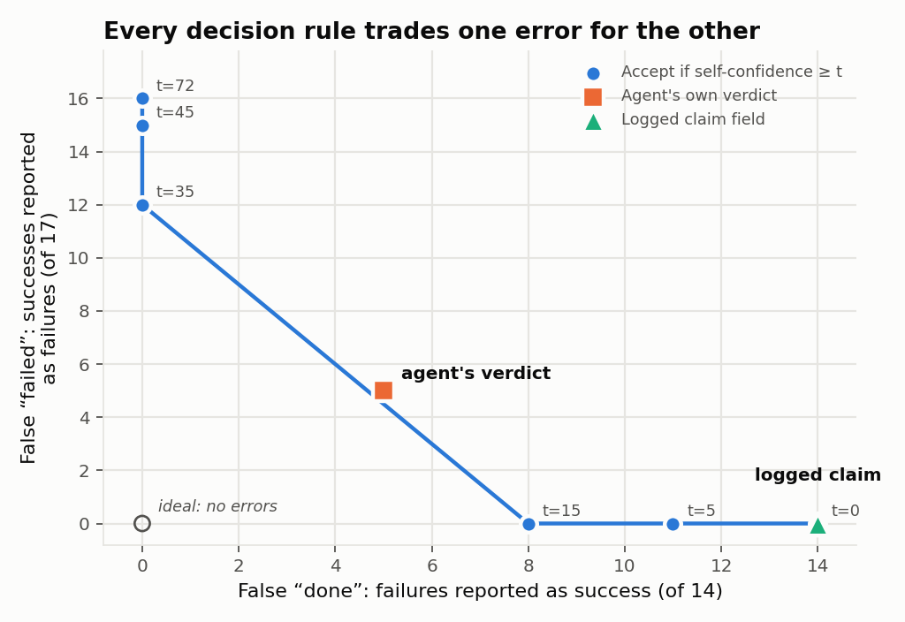
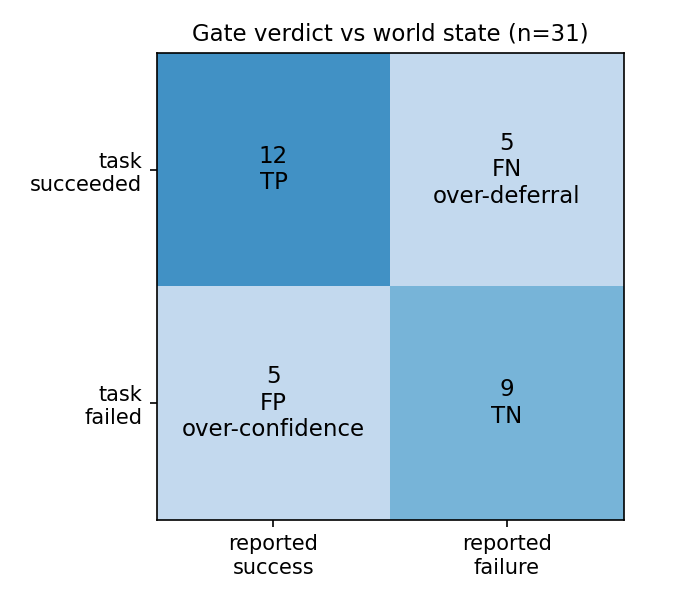
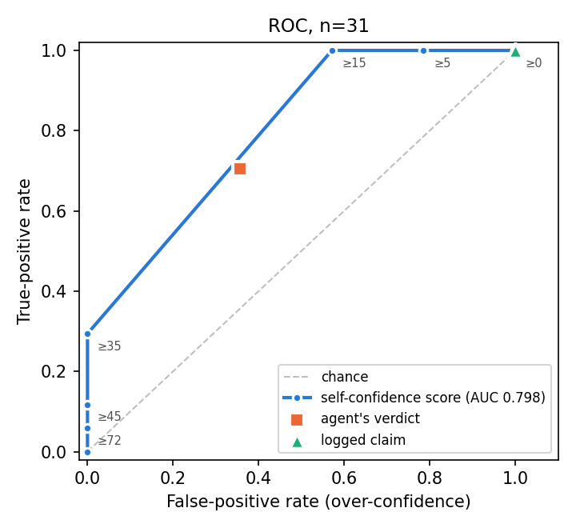

# Can an LLM agent's "done" be trusted?

[](https://github.com/AlishbaFatima12/beepsme-verification-gate-eval/actions/workflows/ci.yml)


An evaluation of the verification gate in BeepSME, a desktop LLM agent I
built. The agent's own "it worked / it failed" reports are scored against what
actually happened on screen, on 31 trials of a 44-task protocol fixed in
advance. Every number below is computed by [`src/evaluate.py`](src/evaluate.py)
and checked by the tests on each push.

**[Open the interactive explorer](https://alishbafatima12.github.io/beepsme-verification-gate-eval/)**:
move the decision threshold and watch the errors shift, browse all 44 tasks,
and compare the two raters. **[Technical report (PDF)](docs/technical_report.pdf)**.
**[Evidence screenshots](evidence/README.md)** from the scored attempts, and the blind rating sheet.

<p align="center"></p>

## Key findings

<!-- findings:start -->
- **The field the protocol named as the agent's claim reports success on 31 of 31 trials**, including every impossible task. It turned out to be hardcoded, so it carries no information.
- **The agent's real verdict is right on 21 of 31 trials (accuracy 0.677).** It errs both ways: 5 over-confident and 5 over-deferring. Every over-deferral has the same cause: `ai_http_413`, a request-size error raised after the content had already been delivered. 4 of the 5 over-confident cases were tasks that could not be done: the gate has no "declined" outcome, so an honest refusal and a silent no-op both end as success.
- **A post-hoc self-confidence score ranks successes above failures (ROC AUC 0.798)**, but coarsely: 20 of 31 trials scored exactly 15, and no failure scored above 15. Mean confidence was lower on failures (9.64) than on successes (23.65).
- **Choosing the decision rule chooses the failure mode.** Counting (over-confident, over-deferring) errors: the claim field gives (14, 0), the verdict (5, 5), and accepting only confidence of 35 or more (0, 12). None of the rules keeps both low.
- **A blind human second rating** of 10 random trials agreed with the first rater on 6 of 8 decidable trials (Cohen's kappa 0.47); 2 were judged undecidable from the evidence.
<!-- findings:end -->

## Research question

Can an LLM agent's own success reports be trusted, and how does the choice of
verification rule change which way it fails: reporting success when the task
failed (over-confidence), or failure when it succeeded (over-deferral)?

## System

BeepSME is a voice-first Windows assistant. It routes a request to a skill
(teach a page, solve homework, read aloud, translate, write a document, guide
through an app, send a message) and acts on the computer. At the end of every
task it decides `ok` or `failed` and shows that to the user
([`src/GATE.md`](src/GATE.md)). The full agent is private. Project page:
<https://beepsme.com>. Portfolio: <https://beepsme.com/portfolio>.

## Method

- **Tasks:** 44 tasks over 7 skills, each with an oracle (a checkable success
  condition) written before the run. They are stratified into happy path,
  over-confidence bait, over-deferral bait and impossible.
- **Protocol fixed in advance:** committed to the private BeepSME repository
  on 2026-06-05. The run was on 2026-08-20. It is not on a public registry.
  Copies, hashes and history: [`preregistration/`](preregistration/PROVENANCE.md).
- **Run:** a driver set each precondition (a local page, the clipboard, an
  app) and typed the command, with the microphone muted
  ([`fixtures/`](fixtures/README.md)).
- **Ground truth:** each trial is labelled 1/0 from world state (saved file,
  answer key, recorded speech, screen), plus whether the task was achievable at
  all. The first rater was an LLM (Claude), working from a sheet that hid the
  agent's report and confidence. These are the labels scored.
- **Human second rating:** I labelled a seeded random sample of 10 trials
  blind to the agent's report, its confidence and the first rater's labels,
  from evidence of the scored attempt only. "Cannot tell" was an allowed
  answer. My labels are published unchanged.
- **Predictors**, with "reports success" as the positive class:
  - the *gate verdict*, the agent's real end-of-task decision;
  - the *logged claim*, the field the protocol named;
  - a *self-confidence score* (0-100, "Proxy A" in the code), from one extra
    grader call per task ([`src/proxy_a.py`](src/proxy_a.py)).

Column definitions for every data file: [`data/README.md`](data/README.md).

**Deviations from the protocol.**
1. 31 of 44 tasks were scored. Not run: 7 WhatsApp send and 5 Canva tutor
   tasks. Excluded: TEACH-04.
2. The logged claim turned out to be hardcoded to "success" for any turn that
   did not crash. So the primary predictor is the real verdict, **a choice
   made after seeing the data**.
3. No frozen build. The second rating was done after I knew the first
   results.

## Results

<!-- results:start -->
Scored trials: 31 of 44 pre-specified tasks (17 world-state successes, 14 failures).

| Metric | Gate verdict (primary) | Logged claim (protocol's field) |
|---|---|---|
| TP | 12 | 17 |
| FP (over-confidence) | 5 | 14 |
| TN | 9 | 0 |
| FN (over-deferral) | 5 | 0 |
| Accuracy | 0.677 | 0.548 |
| Precision | 0.706 | 0.548 |
| Recall | 0.706 | 1.000 |
| Specificity | 0.643 | 0.000 |
| False-positive rate | 0.357 | 1.000 |
| False-negative rate | 0.294 | 0.000 |

Gate verdict 95% Wilson intervals: accuracy 0.501 to 0.814, false-positive rate 0.163 to 0.612, false-negative rate 0.133 to 0.531.

Self-confidence score: ROC AUC 0.798 (bootstrap 95% CI 0.677 to 0.906). Mean score 23.65 on successes, 9.64 on failures; highest score on any failure 15, lowest on any success 15. Mean score 12.14 where the gate verdict was right, 28.20 where it was wrong.

Over-confidence vs over-deferral under each decision rule (same 31 trials):

| Decision rule | Reports success on | FP (over-confidence) | FN (over-deferral) |
|---|---|---|---|
| Logged claim | 31 | 14 | 0 |
| Gate verdict | 17 | 5 | 5 |
| Confidence >= 72 | 1 | 0 | 16 |
| Confidence >= 45 | 2 | 0 | 15 |
| Confidence >= 35 | 5 | 0 | 12 |
| Confidence >= 15 | 25 | 8 | 0 |
| Confidence >= 5 | 28 | 11 | 0 |
| Confidence >= 0 | 31 | 14 | 0 |

Human second rating: 10 randomly drawn trials, labelled blind. 2 were marked "cannot tell from the evidence". On the other 8, the two raters agreed on 6 (observed agreement 0.750, Cohen's kappa 0.467).
<!-- results:end -->

<p>


</p>

## Limitations

- **Small sample:** 31 trials, one agent, one day, wide intervals.
- **Rating:** kappa on 8 trials is a rough estimate. The first rater is from
  the same model family as the agent. The second rater built the system and
  knew the headline results. Where the raters disagree, the first rater's
  label is scored.
- **Declining has no correct label:** where declining was the right
  behaviour, the world-state label is still 0.
- **The confidence score had a wrong input:** it was always told "Reported
  outcome: success". It is also a post-hoc grader, not the agent's in-loop
  belief.
- **Partial evidence is published:** screenshots and speech capture show the
  operator's desktop and stay private. The run logs are private too.
  [`src/extract.py`](src/extract.py) documents how `data/` was taken from
  them, and `data/raw/` keeps the exact lines used.

## What I would do next

- **Give the gate a third outcome, "declined",** and score refusals on their
  own. 4 of the 5 false successes above need it.
- **Tie the verdict to what the user received,** not to steps after
  delivery. That removes every false failure seen here.
- **Study the report as feedback to the user:** which format ("done",
  "declined", a confidence, or the evidence itself) helps people catch the
  agent's mistakes.
- **Run the 13 missing tasks with several human raters,** so that
  disagreement about what an oracle means can be measured, not just noted.

## Reproduce

Requires Python 3.11 or newer.

```bash
python -m venv .venv
.venv\Scripts\activate        # macOS/Linux: source .venv/bin/activate
pip install -r requirements.txt
python src/evaluate.py        # writes results/
pytest -q
```

No API key is needed. The tests check:
- the metric maths against hand-made examples with known answers;
- that `data/gate_outputs.csv` follows from the raw log lines;
- that a fresh run reproduces `results/` and both README blocks exactly.

```
data/             tasks, labels, agent outputs (+ raw log lines, second rating)
preregistration/  the protocol and task list as committed before the run
fixtures/         the pages and clipboard text the agent was given
src/              metrics.py (statistics), evaluate.py (analysis + CLI),
                  report.py (tables, figures), derive.py and extract.py
                  (how data/ was built), proxy_a.py (the confidence scorer)
results/          results.json, generated tables, figures
tests/            unit and reproduction tests
```

## Related notes

<https://github.com/AlishbaFatima12/agent-reliability-notes>

## Contact and citation

Syeda Alishba Fatima, alishbafatima25@gmail.com, ORCID
[0009-0007-7901-3224](https://orcid.org/0009-0007-7901-3224).
Cite via [`CITATION.cff`](CITATION.cff). MIT license.
