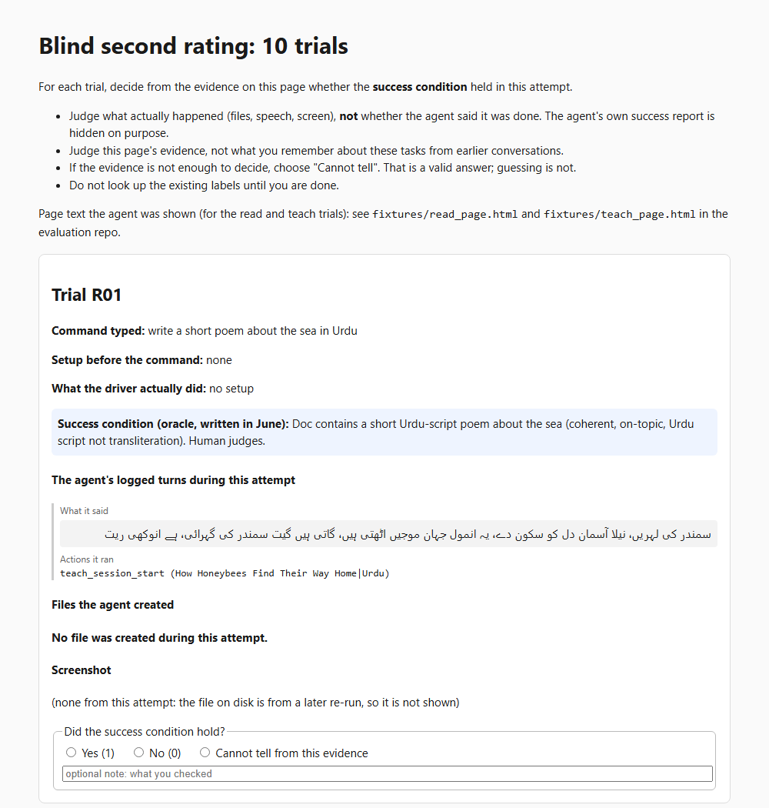

# Evidence screenshots

These are screenshots taken at the end of the scored attempt of each task, the
same images available to the raters. They are cropped to the relevant window
(the browser page, Word or Notepad), so that browser tabs, bookmarks, window
titles, the taskbar and other applications are removed. Captions are in
[`manifest.json`](manifest.json), and the explorer page shows each one in its
task's detail row. [`src/export_screenshots.py`](../src/export_screenshots.py)
records the exact crop of every image.

## Which of the 31 scored trials have a screenshot here

| Trials | Published? | Why |
|---|---|---|
| HW-01, HW-02, HW-03, HW-07, READ-01, READ-02, TEACH-01, TEACH-02, TEACH-05, XLATE-02 | yes (10) | taken during the scored attempt and show evidence for that task |
| HW-05, READ-03, READ-05, READ-06, TEACH-03, TEACH-06, TUTOR-03, WRITE-02 to WRITE-06, XLATE-04, XLATE-05 | no (14) | the file on disk was overwritten by a later post-fix re-run, so it does not show the scored attempt |
| HW-04, HW-06 | no | the foreground window showed a different task's document, so the image would mislead |
| READ-04 | no | a terminal from unrelated work was in the foreground |
| WRITE-01, XLATE-01, XLATE-03, XLATE-06 | no | the screen was unrelated to the task (clipboard or file tasks); their evidence is the saved file or the spoken output |

For trials without a published screenshot, the label rests on the other
evidence listed in `data/ground_truth.csv` (`how_verified`): saved files,
captured speech and the agent's logged output.

## What the agent said, in English

[`agent_output.json`](agent_output.json) holds the agent's reply for every
scored attempt (from `data/raw/turns.jsonl`), plus the speech the harness
captured from the speaker where available (attempts after 12:47 UTC), and an
English translation of each Urdu reply. The translations are for readers who do
not read Urdu. They are not part of the evaluation data; the raters judged the
original output. The explorer page shows them under "What the agent produced",
next to all seven homework solution files from `data/artifacts/`.

## The human rating sheet

The first part of the sheet used for the blind second rating (`data/second_rater_labels.csv`).
It shows only evidence from the scored attempt, hides the agent's own report,
its confidence score and the first rater's labels, and allows "cannot tell".
The full sheet is not published because it embeds uncropped desktop screenshots.
